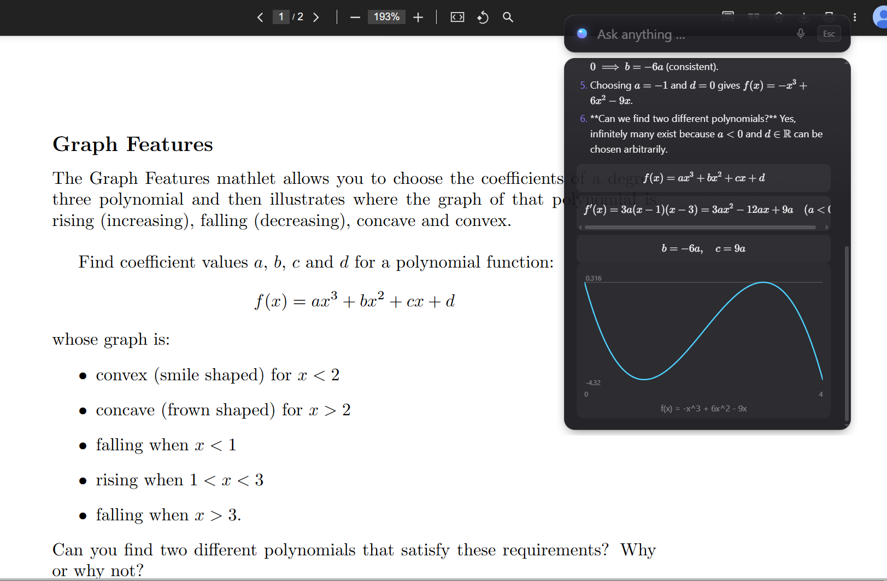
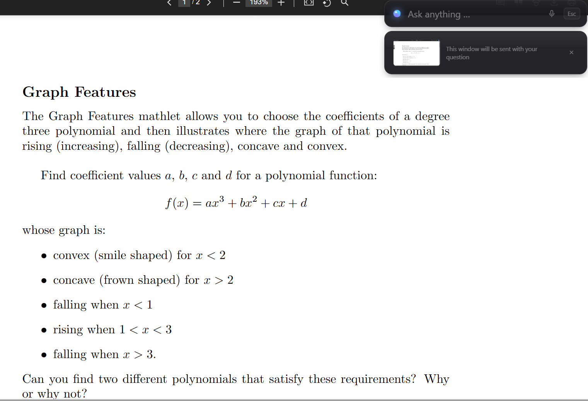
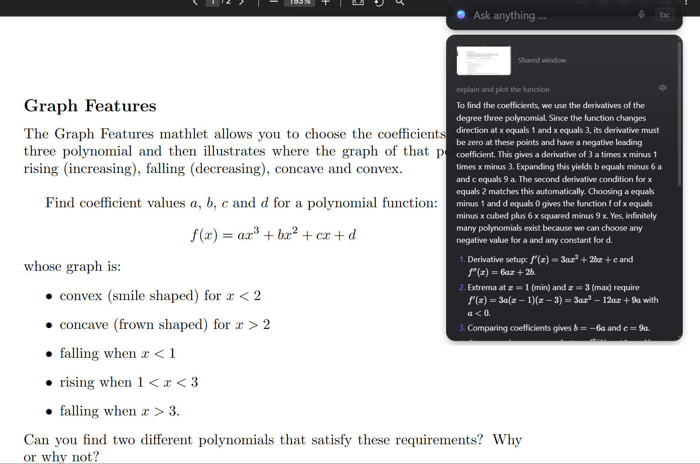
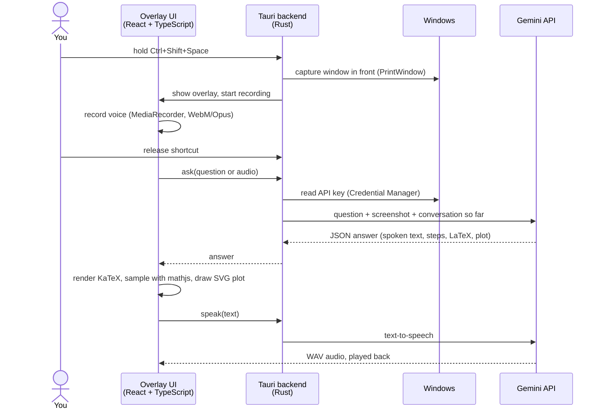

<div align="center">

# malum

**A Windows overlay that explains your exercise sheets.**

Hold a shortcut, ask "Explain exercise 1b" or "Plot the function in 2a", let go.<br>
malum looks at the window you have open, explains it out loud, shows the key formulas and plots functions.

[](#development)
[](https://tauri.app)
[](src-tauri/src)
[](src)
[](LICENSE)

<br>



</div>

> Work in progress. The name is a placeholder.

## Features

- **Push-to-talk or type.** Tap <kbd>Ctrl</kbd>+<kbd>Shift</kbd>+<kbd>Space</kbd> to type, hold it to ask by voice.
- **Sees what you see.** The window in front is captured on key press, with a preview you can remove before sending.
- **Explains out loud.** A spoken explanation plus short steps, read aloud with natural text-to-speech.
- **Real math.** Formulas are typeset with KaTeX, functions are plotted right in the answer.
- **Follow-up questions.** Ask "why?" and malum keeps the context of the conversation.
- **English or German.** It answers in the language you ask in.
- **Private by design.** Nothing is written to disk, and the API key stays in the Windows Credential Manager.

| Before asking: the window that will be shared | The spoken explanation, with steps below |
|:---:|:---:|
|  |  |

<sub>Exercise in the screenshots: "Graph Features" from
[MIT OpenCourseWare 18.01SC Single Variable Calculus](https://ocw.mit.edu/courses/18-01sc-single-variable-calculus-fall-2010/),
Fall 2010, licensed under [CC BY-NC-SA 4.0](https://creativecommons.org/licenses/by-nc-sa/4.0/).</sub>

## How it works



A few details worth knowing:

- **The API key never reaches the UI.** All requests run on the Rust side.
- **Stateless conversations.** The full history is sent with each question and Google stores
  nothing (`store: false`); the screenshot goes with the first question only.
- **Robust against overload.** When a model is busy (HTTP 503), malum falls back to the next one.
- **Every step can be interrupted.** <kbd>Esc</kbd> cancels recording, the request and playback.

Design decisions and their reasons are logged in [docs/DESIGN.md](docs/DESIGN.md).

## Getting started

On first use, malum asks for a free [Gemini API key](https://aistudio.google.com) and stores it in
the Windows Credential Manager.

**Privacy note:** only the window in front is captured, never the whole screen. On Gemini's free
tier, Google may use inputs to improve its products, so only use malum with exercise material.

## Development

Requires Node.js, Rust and the [Tauri prerequisites](https://tauri.app/start/prerequisites/).

```powershell
npm install
npm run tauri dev     # run
npm run tauri build   # build the installer
```

To try it without your own material, open [`docs/demo/sheet.html`](docs/demo/sheet.html) in a
browser and ask about it.

```
src/              overlay UI (React): answer view, KaTeX, plots, voice recording
src-tauri/src/    backend (Rust): shortcut, tray, window capture, key storage, Gemini client
spikes/api/       standalone script used to validate the Gemini API before building the app
docs/             design notes, screenshots and the demo exercise sheet
```

Built with the help of [Claude Code](https://claude.com/claude-code).

## License

[MIT](LICENSE)
